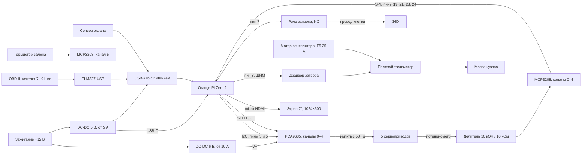

# Как пользоваться OpenVaz

Две разные машины, их легко перепутать.

| | Эмулятор на компьютере разработчика | Целевой компьютер в машине |
|---|---|---|
| Что это | QEMU: 4 ядра Cortex-A53, 512 МБ, обычная ARM-система | Orange Pi Zero 2, H616, 512 МБ |
| Панель | Гость QEMU, окно 1024×600 | Экран 7″ по micro-HDMI, касания по USB |
| Автомобиль | Программа `openvaz-car` на этом же компьютере | Настоящая Kalina и ЭБУ по ELM327 |
| Диск | `emu/build/disk.img` | Карта microSD. Образ QEMU на неё не пишется |

Пока платы нет, разработкой занимается первая колонка. Список деталей и схема ниже относятся ко второй.

## 1. Эмуляторы

На хосте панель и автомобиль можно запустить двумя окнами без виртуальной машины.
Они соединяются напрямую через Unix-сокет. Для проверки ARM-гостя сохранён режим QEMU:
там панель использует `/dev/ttyAMA1`, а QEMU выводит этот порт в тот же сокет.
`ttyAMA0` занят текстовой консолью гостя.

### Два окна без QEMU

Из каталога проекта, в первом терминале:

```sh
cargo fetch
emu/panel.sh
```

Во втором:

```sh
emu/car.sh
```

Порядок запуска любой. Панель слушает `emu/build/car.sock`, автомобиль подключается к ней.
У автомобиля должно появиться «панель на связи», а на экране ЭБУ — температура жидкости.
Восстановление связи после перезапуска любого окна выполняется автоматически.
Панель обслуживает порт и обновляет показания без нажатий мышью.
Окна поддерживают нативный Wayland и X11 с автоматическим выбором.
Не запускайте QEMU и оконную панель одновременно на одном сокете.

### Вариант с QEMU

### Что поставить на компьютер разработчика

- `qemu-system-aarch64`
- `rustc` и `cargo`, цель `aarch64-unknown-linux-musl`
- `python3`, `parted`, `mke2fs`, `cpio`, `gzip`, `unshare`

Скрипты сами находят корень проекта. Эмулятор автомобиля собирается с `--offline`,
поэтому на новой машине зависимости скачиваются один раз, из каталога проекта:

```sh
cargo fetch
```

Линкер цели `aarch64-unknown-linux-musl` — `rust-lld` из `.cargo/config.toml`. Каталог `rustlib/…/bin` из sysroot rustc должен быть в `PATH`. `emu/build-image.sh` добавляет его сам.

### Собрать диск панели

Один раз и заново после правки панели, шрифтов или `emu/init`:

```sh
emu/build-image.sh
```

Скрипт собирает статическую `openvaz` под aarch64, скачивает в `emu/cache` ядро и пакеты Alpine, если их ещё нет, и пишет `emu/build/disk.img`. Корень гостя только для чтения. Второй раздел диска — настройки климата, они переживают перезапуск. Ядро Alpine и initramfs лежат рядом: `emu/build/vmlinuz`, `emu/build/initramfs.img`.

Этот файл — диск виртуальной машины `virt`. Загрузчик Orange Pi его не примет.

### Запустить панель в QEMU и автомобиль

Два терминала. Порядок не важен: пока сокета нет, эмулятор автомобиля ждёт. Если от прошлого запуска осталось окно QEMU, его закрывают до нового `emu/run.sh`: скрипт заново создаёт сокет.

Первый терминал, панель:

```sh
emu/run.sh
```

Окно 1024×600. Мышь заменяет палец. В этом же терминале видна консоль гостя. Машина QEMU: `virt`, `cortex-a53`, 4 ядра, 512 МБ, без сети, видео virtio-gpu.

Второй терминал, автомобиль:

```sh
emu/car.sh
```

Без аргумента это заводская прошивка **Итэлма М74**, калибровка `I444CE08`. Вторая прошивка:

```sh
emu/car.sh январь-7.2
```

Это **Январь 7.2**, калибровка `I201CO58`. Неизвестное имя печатает список и завершает программу с кодом 2. Скрипт сам собирает `openvaz-car` и подключается к `emu/build/car.sock`.

Панель раз в секунду повторяет текущие команды климата, поэтому эмулятор, открытый позже, получает уже выставленные заслонки и вентилятор.

Остановка: `Ctrl+C` в каждом терминале. Окно панели закрывается вместе с виртуалкой.

### Что видно на панели

Свайп влево идёт по кругу: климат, ЭБУ, показания, движение. Свайп вправо возвращает на предыдущий экран. Четыре точки внизу показывают, какой экран открыт.

**Климат.** Слева схема потоков воздуха. Справа задание температуры, ползунок от 16 до 28 °C, пять положений вентилятора вместе с «Выкл». Нижний ряд: лицо, ноги, стекло, рециркуляция, кондиционер. Смешанный обдув — это несколько направлений сразу. Кнопка справа сверху подписана «Вручную». Нажатие включает режим «Климат»: заслонка температуры и вентилятор держат заданные градусы по строке `салон` от автомобиля. Любое ручное касание ползунка, вентилятора или кнопок направления возвращает «Вручную». Кондиционер после каждой загрузки выключен, даже если в прошлый раз он был включён. При выключенном вентиляторе кнопка кондиционера сначала включает нижнюю скорость вентилятора.

**ЭБУ.** Температура охлаждающей жидкости, коды ошибок, муфта компрессора. Муфту включает эмулятор, когда на панели включён кондиционер, вентилятор уже крутится и жидкость ниже 105 °C. Перегрев приходит кодом `P0217`.

**Показания.** Только каналы выбранной прошивки. У М74 есть второй датчик кислорода, у Января 7.2 его нет. Чужой канал панель отбрасывает.

**Движение.** Скорость, обороты, передача, состояние мотора и три педали.

Если остановить `emu/car.sh`, через три секунды ЭБУ, показания и движение пишут «нет связи с ЭБУ». Климат при этом остаётся и продолжает хранить настройки.

### Клавиатура автомобиля

Клавиши работают в окне автомобиля и в настоящем терминале `emu/car.sh`. В окне педаль держится, пока клавиша или кнопка мыши нажата. В терминале педаль держится, пока клавиша повторяется, и сцепление сходится плавно. С газом на первой передаче машина трогается, брошенное сцепление без газа глушит мотор. При включённом зажигании мотор уже работает на холостом ходу.

| Действие | Латиница | Русская раскладка |
|---|---|---|
| Газ | `W` или стрелка вверх | `Ц` |
| Тормоз | `S` или стрелка вниз | `Ы` |
| Сцепление | `A` или стрелка влево | `Ф` |
| Передачи 1–5 | `1` … `5` | те же цифры |
| Нейтраль | `N` | `Т` |
| Задняя | `R` | `К` |
| Зажигание | `I` | `Ш` |
| Стартёр | `Enter` | `Enter` |

Если у компьютера есть экран, `emu/car.sh` открывает окно автомобиля и обновляет его 120 раз в секунду. Скрипт собирает оптимизированную программу: отладочная сборка рисует один кадр дольше 8 мс и до 120 не дотягивает. В окне скорость, обороты, передача, жидкость, показания выбранной прошивки, педали справа и ряд передач внизу. Газ, тормоз, сцепление и стартёр можно держать мышью. Те же клавиши работают в окне и отпускаются сразу, как только их отпустили. Клик по передаче или зажиганию переключает их.

Без экрана в терминале автомобиля остаётся таблица на русском: мотор, передача, обороты, скорость, педали, команда и положение каждой заслонки, задание температуры, вентилятор, запрос кондиционера, муфта, температура жидкости и ошибки. Там педаль держится, пока клавиша повторяется. Заслонка догоняет команду, вентилятор раскручивается с запаздыванием, жидкость прогревается примерно до 90 °C. Зажигание выключено — жидкость остывает к 25 °C.

### Панель без виртуалки

Чтобы просто посмотреть экраны на хосте, в окне:

```sh
cargo run --bin openvaz
```

Кадр без окна:

```sh
cargo run --bin openvaz -- --dump-ppm climate.ppm
cargo run --bin openvaz -- --dump-ppm readings.ppm --screen readings
```

Имя экрана: `climate`, `ecu`, `readings`, `drive`. Оконная панель по умолчанию слушает
`emu/build/car.sock` из каталога проекта и соединяется с `emu/car.sh` без QEMU.
Для другого сокета: `cargo run --release --bin openvaz -- --car-socket /tmp/openvaz.sock`;
автомобилю в таком случае передайте тот же путь аргументом `openvaz-car`.
Если явно задать `OPENVAZ_CAR=/dev/tty...`, окно использует указанный последовательный порт.
Framebuffer-режим `--fb` сохраняет подключение к `/dev/ttyAMA1` или `OPENVAZ_CAR`.
При `--dump-ppm` сокет не открывается.

### Что пересобирать

| Что изменилось | Команда |
|---|---|
| Панель, шрифты, `emu/init` | `emu/build-image.sh`, затем `emu/run.sh` |
| Только эмулятор автомобиля | `emu/car.sh` |

Старый гость не знает новых строк порта. После правки панели диск собирают заново, иначе на экране останется предыдущая программа.

## 2. Прошивка целевого компьютера

Целевой компьютер — Orange Pi Zero 2. Перед записью карты надпись на плате сверяется: **H616, 512 МБ, USB-C, micro-HDMI**. Это не Orange Pi Zero 2W.

Готового образа «вставил карту — сразу панель, корень только для чтения» ещё нет. `emu/build/disk.img` для этой платы не годится. Ниже два разных носителя: отладочная карта, которой можно пользоваться сейчас, и итоговый образ, которого ещё нет.

### Отладочная карта

Это обычный Armbian, чтобы проверить экран, сенсор и программу. Корень на ней записываемый. Образ, записанный в задаче запуска платы:

`Armbian_25.5.1_Orangepizero2_bookworm_current_6.12.23_minimal.img.xz`

Карта отдельная, не та, на которой потом поедет машина. Запись с компьютера разработчика, устройство карты смотрится через `lsblk` до и после вставки. В примере ниже это `/dev/sdX`. Буква берётся из `lsblk`, чужой диск этой командой сотрётся.

```sh
xzcat Armbian_25.5.1_Orangepizero2_bookworm_current_6.12.23_minimal.img.xz \
  | sudo dd of=/dev/sdX bs=4M status=progress conv=fsync
```

Карта вставляется в плату, питание 5 В приходит на USB-C. Первый вход в Armbian — по его собственной инструкции (пароль по умолчанию, сеть). Дальше на компьютере разработчика собирается панель:

```sh
export PATH="$HOME/.cargo/bin:$(rustc --print sysroot)/lib/rustlib/x86_64-unknown-linux-gnu/bin:$PATH"
cargo build --release --target aarch64-unknown-linux-musl --no-default-features --offline
```

Получается `target/aarch64-unknown-linux-musl/release/openvaz`. Файл копируется на плату (`scp` или флешка) и запускается от экранного framebuffer:

```sh
./openvaz --fb /dev/fb0
```

Экран 1024×600 подключается по micro-HDMI. Сенсор и, когда он есть, ELM327 сидят на USB-хабе с отдельным питанием 5 В: у платы один USB. Пока панель на экране и палец двигает ползунок, на плате же запускается `emu/board-report.sh`. Он печатает модель, ядро, размер framebuffer, USB, устройства ввода и память процесса. Эта проверка на настоящей плате ещё не снималась.

Пока переменная `OPENVAS_OUTPUT` не равна `hardware`, программа шлёт климат в текстовый порт, как в QEMU, и железо не трогает.

### Итоговый образ для машины

Его собирает отдельная задача, она открыта. Карта должна загружаться сразу в панель, корень только для чтения, настройки на разделе `openvaz-data`. Пока этого скрипта нет, в машину отладочную карту как постоянную систему не ставят: обрыв зажигания может повредить записываемый корень.

В госте QEMU тот же принцип уже работает. `emu/init` монтирует корень только для чтения, настройки кладёт в `/var/lib/openvaz`, кормит `softdog` и крутит `openvaz --fb /dev/fb0`. На плате пути другие: framebuffer тот же `/dev/fb0`, ЭБУ ожидается на `/dev/ttyUSB0`, шины — как в разделе про железо.

### Железо на уже загруженной плате

Программа ищет устройства по таким путям. Если ядро пронумеровало шины иначе, путь задаётся переменной, номера в коде не правятся.

| Что | По умолчанию | Переменная |
|---|---|---|
| Выходы включены | выключены, команды идут в текстовый порт | `OPENVAS_OUTPUT=hardware` |
| PCA9685, адрес 0x40, 50 Гц | `/dev/i2c-3` | `OPENVAS_I2C` |
| GPIO, линии пинов 7 и 11 | `/dev/gpiochip1` | `OPENVAS_GPIOCHIP` |
| OE, пин 11, линия 70 | активный низкий | `OPENVAS_GPIO_OE` |
| Запрос кондиционера, пин 7, линия 73 | высокий уровень включает реле | `OPENVAS_GPIO_AC` |
| ШИМ вентилятора, пин 8, PWM2 | `/sys/class/pwm/pwmchip0`, канал 2, период 50 мкс | `OPENVAS_PWM_CHIP`, `OPENVAS_PWM_CHANNEL` |
| MCP3208 | `/dev/spidev1.0` | `OPENVAS_SPI` |
| Настройки и калибровка | каталог `OPENVAS_STATE_DIR`, файлы `settings` и `servos` | `OPENVAS_STATE_DIR` |

Пин 8 станет ШИМ только если в дереве устройств включён оверлей pwm и на этом пине выключен UART5. После загрузки должен появиться `pwmchip0` и канал 2. Имя оверлея сверяется по плате: в репозитории записано требование, не готовая строка `armbianEnv.txt`.

Калибровка заслонок — файл `servos` рядом с `settings`. Пока файла нет, импульсы серв не разрешаются: подтяжка OE держит их выключенными. Строка, комментарий после `#`:

```
канал мкс_при_0 мкс_при_1 инверсия вольт_при_0 вольт_при_1
```

Канал 0–4. Импульсы от 500 до 2500 мкс. Инверсия `1` или `0`. Два напряжения — показания АЦП в тех же крайних положениях. Показание вне этого промежутка, с запасом 0,08 В, заслонку не двигает. Пример, числа подставляются после замера на столе:

```
1 1000 2000 0 0.50 2.40
```

Крайние импульсы и напряжения с машины ещё не сняты. В файл не пишутся выдуманные микросекунды.

Запуск с железом, когда калибровка уже лежит в каталоге настроек:

```sh
OPENVAS_OUTPUT=hardware OPENVAS_STATE_DIR=/var/lib/openvaz ./openvaz --fb /dev/fb0
```

Порядок старта в этом режиме: прочитать пять потенциометров и термистор, выставить импульсы в измеренные положения, только потом разрешить OE, затем вести заслонки к сохранённой цели. Вентилятор получает сохранённую скорость. Запрос кондиционера сам не включается.

## 3. Список комплектующих

Ток мотора печки и ток провода кнопки кондиционера ещё не измерены. Поэтому у полевого транзистора, диода и реле в списке требования, а не магазинный артикул. Предохранитель F5 штатной цепи вентилятора остаётся 25 А: в этой цепи есть и другие потребители, номинал не увеличивают и предохранитель не обходят.

| Сколько | Деталь | Зачем | На что смотреть |
|---|---|---|---|
| 1 | Orange Pi Zero 2, 512 МБ | Компьютер модуля | H616, micro-HDMI, USB-C, 512 МБ. Один USB, нужен хаб |
| 1 | Карта microSD | Система и настройки | От 16 ГБ. На итоговой карте корень только для чтения и отдельный раздел настроек |
| 1 | Экран 7″, 1024×600 | Панель вместо блока климата | Картинка по HDMI, касания по USB. Экран со шлейфом Raspberry Pi не подходит |
| 1 | Кабель micro-HDMI — HDMI | Картинка | Длина до места панели |
| 1 | USB-хаб с питанием | Сенсор и ELM327 одновременно | Питание хаба от преобразователя 5 В |
| 1 | ELM327, USB | Чтение ЭБУ по K-Line | ISO 9141-2 и ISO 14230. Адаптер только с CAN на этой Калине не заговорит |
| 1 | DC-DC 12 → 5 В, от 5 А | Плата, хаб, экран | Автомобильный вход, работа при просадке стартера, свой предохранитель |
| 1 | DC-DC 12 → 6 В, от 10 А | Пять сервоприводов | Отдельный от питания платы, свой предохранитель. Ток пяти заторможенных серв не больше его предела |
| 5 | Сервопривод с четвёртым проводом потенциометра | Заслонки | 5–6 В, импульс 50 Гц, аналоговый выход положения, металлический редуктор |
| 1 | Модуль PCA9685 | Импульсы пяти серв | Логика от 3,3 В. V+ только от 6 В. OE подтянуть к 3,3 В |
| 1 | MCP3208 | Потенциометры и термистор | Питание и Vref 3,3 В, SPI. Восемь каналов, заняты шесть |
| 10 | Резистор 10 кОм, 1% | Делители пяти потенциометров | На канал два резистора: середина на АЦП. При 6 В на входе делителя на АЦП 3 В |
| 1 | Резистор 10 кОм, 1% | Верхнее плечо термистора | От 3,3 В к термистору |
| 1 | N-канальный полевой транзистор | Ключ мотора печки | Сток-исток от 60 В, ток с запасом к измеренному току мотора, малое сопротивление канала, теплоотвод. Затвор 10–12 В |
| 1 | Драйвер затвора | ШИМ 3,3 В поднимает затвор до 10–12 В | Вход совместим с 3,3 В. Около 100 Ом в затворе и 100 кОм с затвора на исток |
| 1 | Диод параллельно мотору | Гасит выброс обмотки | Катодом к плюсу мотора, ток не ниже тока мотора |
| 1 | Реле, контакт нормально разомкнут | Повторяет штатную кнопку кондиционера | Катушка 5 В, диод параллельно катушке. Если по проводу кнопки идёт заметный ток, реле автомобильное |
| 1 | Транзистор катушки реле | Пин 7 не держит катушку напрямую | Между пином 7 и катушкой |
| 2 | Предохранитель на входе преобразователя | Новые линии 12 В | Номинал по входному току своего преобразователя |
| — | Провода и общая масса | Силовые и сигнальные трассы | Мотор и сервы: отдельные толстые минусы на кузов. У платы свой тонкий минус туда же |

Термистор салона уже стоит в машине, около 10 кОм при +25 °C. В программе перевод напряжения в градусы идёт с расчётной бетой 3950. Замер на машине потом меняет одну константу.

В модуль не входят обогрев стекла, зеркал и сидений, чтение ABS и подушек, сброс ошибок и прошивка ЭБУ.

## 4. Схема подключения

Питание модуля появляется вместе с зажиганием и пропадает, когда зажигание выключается. Минусы обоих преобразователей и исток ключа вентилятора сходятся на массе кузова в одной точке. Ток мотора через плату не возвращается. Пины 2 и 4 гребёнки (5 В платы) мотором и сервами не нагружаются.



### Пины 40-контактной гребёнки

Нумерация как у совместимой с Raspberry Pi гребёнки. Логика 3,3 В.

| Пин | Куда | Программа |
|---|---|---|
| 3, 5 | SDA и SCL модуля PCA9685, подтяжки к 3,3 В | `/dev/i2c-3`, адрес 0x40 |
| 19, 21, 23, 24 | MOSI, MISO, SCLK, CS модуля MCP3208 | `/dev/spidev1.0` |
| 7 | Через транзистор на катушку реле запроса | `gpiochip1`, линия 73, высокий уровень включает реле |
| 8 | Вход драйвера затвора вентилятора | PWM2, `pwmchip0` канал 2. UART5 на этом пине выключен |
| 11 | Вход OE у PCA9685 | `gpiochip1`, линия 70. Низкий уровень разрешает импульсы |
| 1, 17 | 3,3 В на логику PCA9685, Vref MCP3208 и верхние плечи делителей | Током серв и мотора не нагружать |
| 6, 9, 14, 20, 25 | Общая земля логики | Тонкий провод на ту же точку кузова, куда приходят минусы преобразователей |

### Пять заслонок

У каждой сервы три силовых провода и четвёртый, с потенциометра.

| Провод сервы | Куда |
|---|---|
| Плюс | V+ модуля PCA9685, а V+ питается только от DC-DC 6 В |
| Минус | Минус того же DC-DC 6 В, дальше на массу кузова |
| Импульс | Свой канал PCA9685, 0–4 |
| Потенциометр | Делитель из двух резисторов 10 кОм. Верхний от провода потенциометра, нижний на массу, середина на канал АЦП |

Логика PCA9685 (VCC) питается от 3,3 В платы, не от линии 6 В. OE подтянут к 3,3 В, поэтому без сигнала с пина 11 импульсов нет. Если выход потенциометра уже не выше 3,3 В, делитель не нужен: на вход АЦП ставится последовательный резистор 1 кОм.

| Канал PCA9685 | Заслонка | Канал MCP3208 | На экране |
|---|---|---|---|
| 0 | Рециркуляция | 0 | Кнопка |
| 1 | Температура | 1 | Ползунок, в режиме «Климат» его ведёт регулятор |
| 2 | Лицо | 2 | Кнопка, можно вместе с другими |
| 3 | Ноги | 3 | Кнопка, можно вместе с другими |
| 4 | Стекло | 4 | Кнопка, можно вместе с другими |
| — | Термистор салона | 5 | Строка `салон`, режим «Климат» |
| — | Запас | 6 и 7 | — |

Штатные тяги заслонок развязываются. Иначе приводы тянут один механизм в разные стороны.

### Термистор салона

Своя пара проводов, без старого блока климат-контроля параллельно.

```
3,3 В ── 10 кОм ──┬── термистор ── масса
                  └── MCP3208, канал 5
```

Напряжение вне 0,05…3,25 В программа отбрасывает.

### Вентилятор печки

```
+12 В после F5 ── мотор ── сток полевого транзистора
                              исток ── масса кузова
                              затвор ← 100 Ом ← драйвер ← ШИМ пина 8
                              100 кОм с затвора на исток
диод параллельно мотору, катодом к стороне +12 В
```

Транзистор работает ключом: полностью открыт или закрыт. Полуоткрытое состояние на токе печки греется на десятки ватт. Затвор тянется к истоку, поэтому без ШИМ мотор стоит. Толстый минус мотора идёт на кузов отдельным проводом.

### Запрос кондиционера

Модуль повторяет штатную кнопку. Муфту компрессора включает сам ЭБУ, силовой провод муфты модуль не трогает. Полярность провода кнопки сначала измеряется на машине.

```
пин 7 → транзистор → катушка реле 5 В
                     диод параллельно катушке
                     контакт NO в разрыв провода кнопки ЭБУ
```

Катушка без тока: контакт разомкнут, запрос выключен.

### ЭБУ

| Контакт OBD-II | Куда |
|---|---|
| 7 | K-Line адаптера ELM327 |
| 4 и 5 | Масса адаптера |
| 16 | Питание адаптера, если он берёт его с колодки |

ELM327 вставляется в USB-хаб вместе с сенсором. Программа ЭБУ не прошивает и адаптации не сбрасывает: с блока читаются температура жидкости, коды и, на живой машине, показания выбранного описания. В работе пара Итэлма М74 (`I444CE08`) и Январь 7.2 (`I201CO58`).

### Что проверить до первого включения в машине

- Надпись на плате: Orange Pi Zero 2, H616, 512 МБ.
- Логика PCA9685 на 3,3 В, OE в покое запрещает импульсы.
- Пять сервоприводов, упёршись одновременно, не превышают ток преобразователя 6 В.
- Ток мотора печки на максимальной скорости измерен, по нему выбраны транзистор, диод и сечение провода.
- Провод штатной кнопки кондиционера измерен при включённом вентиляторе: что именно замыкает кнопка и какой там ток.
