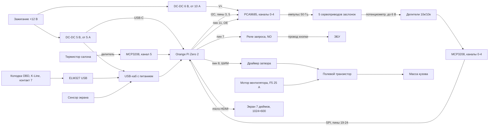

# Модуль климата для Lada Kalina

Универсальная программа на микрокомпьютере. Первая машина: Lada Kalina 2010 года, бензин. Другие
Lada подключаются отдельным профилем, без новой программы.

Плата по имеющимся признакам: Orange Pi Zero 2, 512 МБ, процессор H616. На ней есть micro-HDMI,
антенна Wi-Fi и один USB. Перед заказом деталей надпись на плате стоит сверить: H616 и питание
USB-C.

## Что модуль делает

Штатные рукоятки и тросы снимаются. На их место печатается панель с экраном 7 дюймов, 1024×600.
Сенсор подключается по USB, картинка по HDMI. Управление климатом только с этого экрана. Если
компьютер не загрузился, климат не работает.

Питание появляется вместе с зажиганием и пропадает, когда зажигание выключается. Корневой раздел
только для чтения, чтобы обрыв питания не портил карту памяти. Настройки климата лежат на
отдельном записываемом разделе.

- Пять заслонок, у каждой свой сервопривод: рециркуляция, температура, лицо, ноги, стекло.
  Смешанный обдув получается, когда включены несколько направлений сразу.
- Температуру воздуха задаёт заслонка. Ползунок на экране задаёт её угол.
- Вентилятор меняет количество воздуха. У штатной ручки пять положений вместе с выключенным.
  В модуле скорость плавная, ШИМ.
- Кондиционер: запрос в ЭБУ, как штатная кнопка. Муфту компрессора включает сам ЭБУ, если
  давление хладагента, температура испарителя и обороты это позволяют.
- С ЭБУ по K-Line читаются температура охлаждающей жидкости и коды ошибок. Запись в блок не
  делается.
- Термистор салона, около 10 кОм при +25 °C, уже стоит в машине. Он нужен для будущего режима
  «климат или вручную».

## Схема соединений



### Узлы

| Узел | Подключение | Важно |
|---|---|---|
| Зажигание +12 В | Линия после замка | На каждый преобразователь свой предохранитель |
| DC-DC 5 В, от 5 А | Плата (USB-C), хаб, экран | Вход с запасом на просадку при стартере |
| DC-DC 6 В, от 10 А | Только сервоприводы (V+ PCA9685) | Землю с преобразователем 5 В соединить в одной точке |
| Масса кузова | Минусы обоих преобразователей, исток ключа вентилятора | Ток мотора через плату не возвращается |
| ЭБУ | Получает запрос кондиционера | Сам держит реле муфты, этот силовой провод модуль не трогает |
| Ключ запроса | Пин 7 через транзистор и реле | Нормально разомкнут: нет тока в катушке, кондиционер выключен |
| Колодка диагностики | K-Line: контакт 7 OBD-II, масса 4 и 5, питание адаптера 16 | |
| ELM327 USB и хаб | Хаб от преобразователя 5 В | На хабе сенсор и адаптер |
| Термистор салона | Делитель → АЦП, канал 5 | Своя пара проводов, без старого блока параллельно |
| Мотор вентилятора | Штатный предохранитель F5, 25 А | Номинал не увеличивать, в той же цепи другие потребители |
| Ключ вентилятора | Пин 8, ШИМ через драйвер затвора | Полностью открыт или закрыт. Затвор тянется к земле: нет ШИМ, мотор стоит |
| Пять заслонок | PCA9685, каналы 0-4 | Штатные тяги развязать, иначе приводы тянут один механизм в разные стороны |
| Потенциометр сервы | Четвёртый провод → делитель → АЦП 0-4 | На вход АЦП не больше 3,3 В. Каналы 6 и 7 свободны |
| Экран | micro-HDMI картинка, USB касания в хаб | Питание от преобразователя 5 В, если есть отдельный разъём |

### Пины Orange Pi Zero 2

| Пин | Назначение |
|---|---|
| 3, 5 | I2C, PCA9685 |
| 19, 21, 23, 24 | SPI, MCP3208 |
| 7 | Запрос кондиционера |
| 8 | ШИМ вентилятора. На H616 это PWM2 (`pwmchip0`, канал 2). Чтобы пин стал ШИМ, нужен оверлей pwm, а UART5 на этом пине должен быть выключен |
| 11 | Разрешение импульсов PCA9685 (OE к массе) |
| 2, 4 | 5 В. Током мотора и серв не нагружать |

## Силовые узлы

### Сервопривод и его потенциометр

- DC-DC 6 В даёт плюс и массу сервы.
- PCA9685 даёт импульс 50 Гц своего канала.
- Четвёртый провод (потенциометр) идёт через делитель на АЦП.
- Логика PCA9685 питается от 3,3 В платы, не от линии 6 В.

### Вентилятор

```
+12 В (F5) ── мотор ── сток [полевой транзистор] исток ── масса кузова
                              затвор ← драйвер ← ШИМ платы
```

- Диод параллельно мотору, катодом к стороне +12 В.
- Толстый минус мотора идёт на кузов. Минус платы: отдельным тонким проводом.
- Плата управляет только затвором.

### Термистор салона

```
3,3 В ── 10 кОм ──┬── NTC ── масса
                  └── АЦП
```

### Запрос кондиционера

```
пин 7 → транзистор → катушка реле 5 В (диод параллельно)
                     контакт NO ── провод кнопки в ЭБУ
```

- Катушка без тока: контакт открыт.
- Полярность провода кнопки сначала измерить на машине.

## Каналы

| Канал серв | Заслонка | Канал АЦП | Орган на экране |
|---|---|---|---|
| 0 | Рециркуляция | 0 | Кнопка |
| 1 | Температура | 1 | Ползунок |
| 2 | Лицо | 2 | Кнопка, можно вместе с другими |
| 3 | Ноги | 3 | Кнопка, можно вместе с другими |
| 4 | Стекло | 4 | Кнопка, можно вместе с другими |
| - | Термистор салона | 5 | Пока только измерение |
| - | Запас | 6 и 7 | - |
| - | Вентилятор | - | Плавный ШИМ, пять положений считая выключенное |
| - | Запрос кондиционера | - | Кнопка. После каждой загрузки выключен |

## Поведение

Пока зажигание выключено, импульсов на сервы нет, контакт запроса разомкнут, затвор вентилятора
притянут к земле. Заслонки остаются там, где их оставили приводы.

После включения программа сначала читает пять потенциометров и термистор. Потом разрешает импульсы
и ведёт заслонки в положения из раздела настроек. Вентилятор получает сохранённую скорость.
Запрос кондиционера сам не восстанавливается: он включится только кнопкой на экране.

Кнопка кондиционера при выключенном вентиляторе сначала включает вентилятор и только потом
замыкает запрос. ЭБУ может оставить муфту выключенной, узнать это можно по диагностике. Давление,
обороты и температуру испарителя модуль отдельно не проверяет.

Если программа перестаёт обслуживать выходы, сторожевой таймер платы её перезагружает. На время
перезагрузки подтяжки держат вентилятор и запрос выключенными. Кормить таймер должен тот же цикл,
который держит выходы, а не соседний процесс.

> Ток базы биполярного транзистора для вентилятора не используется. Мотор стоит на силовой цепи
> с предохранителем 25 А. Полуоткрытый транзистор греется на десятки ватт, а вывод платы нужный
> ток базы не отдаёт. Полевой транзистор работает ключом.

## Программа

Одна программа на Rust, на весь экран, по-русски, без рабочего стола, рассчитана на 512 МБ памяти.
Отличия машин сидят в профиле. Первый профиль: Kalina 2010, K-Line, пять заслонок.

Главный экран: климат. Свайп открывает второй экран: температура охлаждающей жидкости и коды
ошибок. Если ЭБУ молчит, на экране ошибка связи. Опрос раз в несколько секунд. Скорости
вентилятора на экране пока нет, хотя в схеме вентилятор уже есть. Туда же позже встанет выбор
«климат или вручную»: термистор для него уже заложен в АЦП.

Первый результат в QEMU: обычная 64-битная ARM-система с 512 МБ памяти, не образ самой Orange Pi.
Корень только для чтения, отдельный раздел настроек, программа стартует сама и открывает оба
экрана. Мышь в QEMU заменяет касание. Движение органа пишет в журнал номер выхода и значение.
Живых данных ЭБУ и настоящих GPIO на этом шаге нет. На карту памяти платы попадают только
проверенные сборки.

## Список деталей

| Сколько | Деталь | Зачем | На что смотреть |
|---|---|---|---|
| 1 | Orange Pi Zero 2, 512 МБ | Компьютер модуля | H616, micro-HDMI, USB-C, 512 МБ. Один USB, нужен хаб |
| 1 | Карта памяти | Система и настройки | От 16 ГБ. Корень только для чтения, отдельный раздел настроек |
| 1 | Экран 7″, 1024×600 | Панель вместо блока климата | Картинка по HDMI, касания по USB. Штатный экран Raspberry Pi со шлейфом не подходит |
| 1 | Кабель micro-HDMI → HDMI | Картинка | Длина до места панели |
| 1 | USB-хаб с питанием | Сенсор и ELM327 одновременно | Питание хаба от преобразователя 5 В |
| 1 | ELM327, USB | Чтение ЭБУ по K-Line | Поддержка ISO 9141-2 и ISO 14230. Адаптер только с CAN на Калине 1 не заговорит |
| 1 | DC-DC 12 → 5 В, от 5 А | Плата, хаб, экран | Автомобильный вход или защита от выбросов, работа при просадке стартера, свой предохранитель |
| 1 | DC-DC 12 → 6 В, от 10 А | Пять сервоприводов | Отдельный от питания платы, свой предохранитель. Ток пяти заторможенных серв не больше его предела |
| 5 | Сервопривод с четвёртым проводом потенциометра | Заслонки | 5-6 В, импульс 50 Гц, аналоговый выход положения. Усилие по рычагу заслонки. Металлический редуктор |
| 1 | Модуль PCA9685 | Импульсы пяти серв | Логика от 3,3 В, чтобы подтяжки I2C не оказались на 5 В. V+ только от 6 В. OE подтянуть к 3,3 В, разрешать импульсы пином 11 |
| 1 | MCP3208 | Потенциометры и термистор | Питание и Vref 3,3 В, SPI. Восемь каналов, заняты шесть |
| 10 | Резистор 10 кОм, 1% | Делители пяти потенциометров | Потенциометр сервы питается от 6 В, четвёртый провод доходит до 6 В. На канал два резистора 10 кОм: середина на АЦП, при 6 В там 3 В. Если выход сервы не выше 3,3 В, делитель не нужен, хватит последовательного 1 кОм |
| 1 | Резистор 10 кОм, 1% | Верхнее плечо термистора | От 3,3 В к термистору, термистор другим концом на массу |
| 1 | N-канальный полевой транзистор | Ключ мотора печки | Сток-исток от 60 В, ток с запасом к измеренному току мотора, малое сопротивление открытого канала, теплоотвод. Затвор 10-12 В, не 3,3 В с гребёнки |
| 1 | Драйвер затвора | ШИМ 3,3 В → затвор 10-12 В | Вход совместим с 3,3 В. Около 100 Ом в затворе и 100 кОм с затвора на исток |
| 1 | Диод параллельно мотору | Гасит выброс обмотки | Катодом к плюсу мотора, ток не ниже тока мотора |
| 1 | Реле с нормально разомкнутым контактом | Повторяет штатную кнопку кондиционера | Катушка 5 В, диод параллельно катушке, транзистор между катушкой и пином 7. Контакт в разрыв провода кнопки. Если по проводу идёт заметный ток, взять автомобильное реле |
| 2 | Предохранитель на входе преобразователя | Защита новых линий 12 В | Номинал по входному току преобразователя. F5 не менять и не обходить |
| - | Провода и общий минус | Силовые и сигнальные трассы | Мотор и сервы: отдельные толстые минусы на кузов. У платы свой тонкий минус туда же. Сигнальные провода вдали от провода мотора |

## Пока не входит

- Обогрев стекла, зеркал и сидений.
- Чтение ABS и подушек, сброс ошибок, адаптации и прошивка ЭБУ.
- Своя плата вместо навесных модулей. Разъём и модули собраны так, чтобы позже перенести их на
  одну плату без смены программы.
- Работа климата при выключенном или незагрузившемся компьютере.

## До включения на машине

Эти проверки разнесены по задачам в [tasks/](tasks/README.md).

- Сверить плату: Orange Pi Zero 2, H616, 512 МБ.
- Измерить провод штатной кнопки кондиционера при включённом вентиляторе и понять, что именно
  замыкает кнопка.
- Измерить ток мотора печки на максимальной скорости и по нему выбрать транзистор, диод и сечение
  провода.
- Проверить, что пять сервоприводов, упёршись одновременно, не превышают ток преобразователя 6 В.
- Убедиться, что логика PCA9685 сидит на 3,3 В, а вывод разрешения импульсов в покое запрещает
  импульсы.
